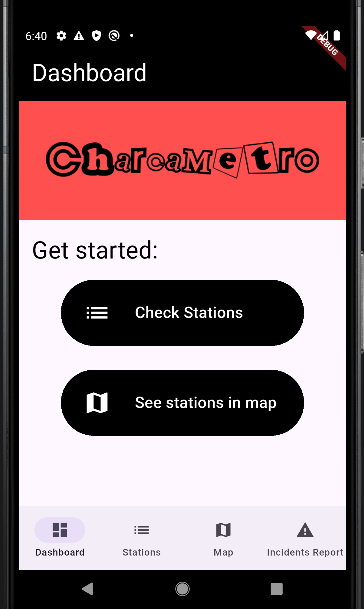

# Team

Rafael Ceres Martínez - a22510504

# Part 1

# Screenshots
## Dashboard

## List

## Details

## Map

## Report Incident

# Functionalities implemented

- Passed teacher tests

- Dashboard includes link to map and station pages

- Added tests to verify that the links in the dashboard page forward to their corresponding pages, and passed them successfully

- Stations are displayed in list and can be searched using the search bar

- Map screen contains an image

- Station details screen shows all of the information, as well as the incidents

- Incident report form works as intended

# Auto evaluation

While I think I implemented all of the functionalities successfully, I could have been more creative on the dashboard. That's why I expect a grade around 14.

# Part 2

# Screenshots

## List

## Map

## Details

Dashboard and incident report screen remain the same as in first submission.

# Functionalities implemented:

- Passed teacher mandatory tests

- Passed teacher optional tests

- Student tests for dashboard (same as in first submission)

- Dashboard with title screen and links to list and map screen.

- Station list using API

- Station map using gogle maps

- Station detail:
  - Distance to station
  - Incident list from database

- Incidents registered in database

- Search bar in station list

- Location for calculating distance to station and also in map.

- Offline functionalities

- Video

# Architecture

The app relies on the Metro Lisboa API for obtaining the information of the stations. After calling it once, all of the stations will be saved into the database, allowing the user to access them if online too.
Upon entering list, map or details screen, the page will ask the metro repository for the stations. If the user is online, the metro repository will use the HTTP datasource, to obtain the latest information. If the user is offline, the metro repository will use the sqflite datasource, obtaining the information saved in the database.
Additionally, the incident reports will be obtained from the database in every case.

# Auto evaluation

I implemented almost all of the functionalities (except for the waiting times), but the dashboard is not very ellaborate and the design is very simple, so I think I'd give me a grade around 14.

# Video link

https://youtu.be/lhZKYUbIGUY

