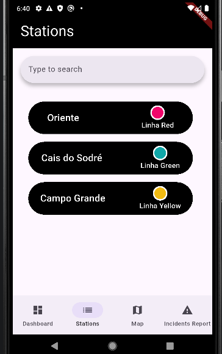
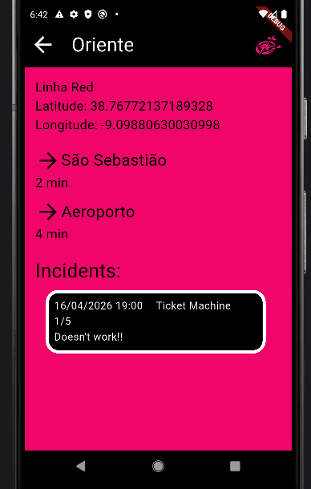
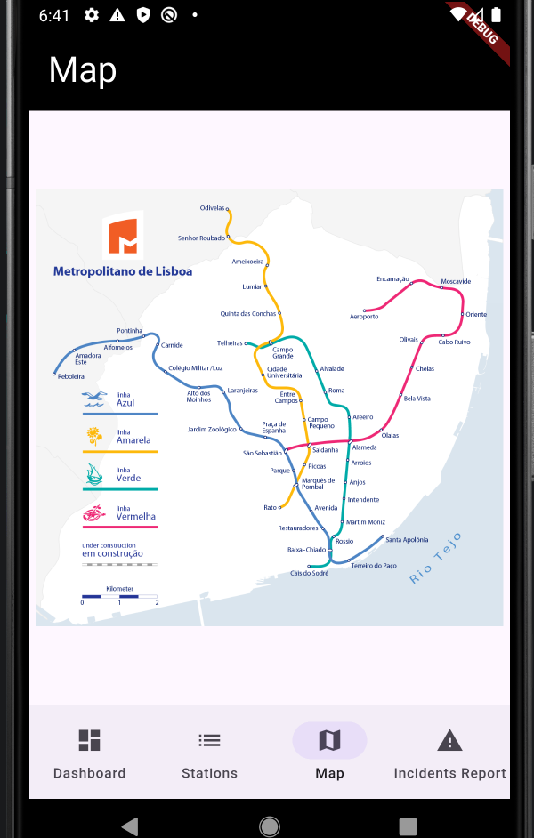
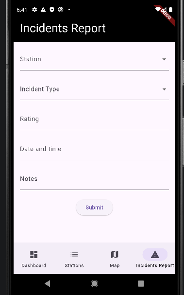

# Team

Rafael Ceres Martínez - a22510504

# Screenshots
## Dashboard

## List

## Details

## Map

## Report Incident

# Functionalities implemented

- Passed teacher tests

- Dashboard includes link to map and station pages

- Added tests to verify that the links in the dashboard page forward to their corresponding pages, and passed them successfully

- Stations are displayed in list and can be searched using the search bar

- Map screen contains an image

- Station details screen shows all of the information, as well as the incidents

- Incident report form works as intended

# Auto evaluation

While I think I implemented all of the functionalities successfully, I could have been more creative on the dashboard. That's why I expect a grade around 14.
